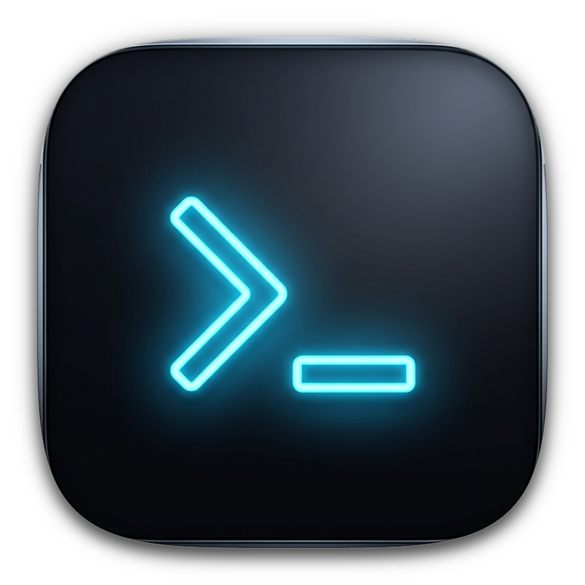

<p align="center">
  
</p>

<h1 align="center">OmniTerminal</h1>

<p align="center">
  인프라 운영 및 시스템 엔지니어링을 위한 고성능 크로스 플랫폼 SSH / SFTP 터미널 클라이언트.
</p>

<p align="center">
  <a href="./README.md">English</a> · <a href="./README_ZH.md">简体中文</a> · <a href="./README_JA.md">日本語</a> · <b>한국어</b>
</p>

<p align="center">
  <a href="https://github.com/leonlwq/OmniTerminal/releases"></a>
  <a href="https://omniterminal.leonlwq.com/ko/"></a>
  <a href="https://github.com/leonlwq/OmniTerminal/blob/main/LICENSE"></a>
  
  
  
</p>

---

## 개요

OmniTerminal은 Go 동시성 네트워킹 코어와 최신 웹 기술 스택(Wails v2 + React 19)으로 구축된 네이티브 데스크톱 SSH/SFTP 클라이언트입니다. 기존 레거시 터미널 도구를 대체하도록 설계되었으며, WebGL GPU 하드웨어 가속 렌더링, 컨텍스트 연동형 SFTP 파일 전송, 로컬 AES-256-GCM 인증 정보 암호화 보관소를 제공합니다.

* **공식 웹사이트**: [https://omniterminal.leonlwq.com/ko/](https://omniterminal.leonlwq.com/ko/)
* **이슈 트래커**: [GitHub Issues](https://github.com/leonlwq/OmniTerminal/issues)

---

## 핵심 엔지니어링 기능

### 1. 현대적인 워크스페이스 아키텍처
- **통합 커맨드 바 (Omnibar)**: `ssh://user@host:port` 단일 라인 입력으로 임시 세션 즉시 연결 (강제 영구 저장 불필요).
- **계층형 세션 트리 관리**: 무제한 중첩 디렉터리, 드래그 앤 드롭 정렬, 컬러 상태 표시 지원. 점프 호스트 및 포트 포워딩 설정을 상위 템플릿으로부터 재귀 상속.
- **VS Code Dark Modern 규격**: 모듈식 5계층 아키텍처 (`internal/app`, `internal/core`, `internal/models`, `internal/config`, `internal/crypto`) 기반 설계.

### 2. 세션 연동형 SFTP 드로어
- **단일 뷰포트 통합**: 별도의 독립 팝업창 없이 터미널 우측에서 부드럽게 슬라이드되는 파일 관리 패널로 현재 작업 디렉터리 및 컨텍스트 유지.
- **동시 전송 엔진**: 멀티스레드 업로드/다운로드 큐, 청크 단위 이어받기, 원격 파일 권한(`chmod`) 관리 지원.

### 3. 로컬 마스터 패스워드 금고 (Zero-Plaintext)
- **PBKDF2 & AES-256-GCM 암호화**: 저장되는 모든 SSH 비밀번호, 개인키, TOTP 시드를 마스터 키 기반 파생 키로 로컬 암호화.
- **평문 저장 배제 및 자동 잠금**: 디스크 내 평문 저장을 완전히 배제하며, 유휴 상태 타임아웃 시 반투명 잠금 화면 자동 실행.

### 4. GPU 하드웨어 가속 렌더링
- **xterm.js WebGL 파이프라인**: 대용량 로그 스트림이 연속 출력되는 환경에서도 안정적인 60 FPS 렌더링 유지.
- **핫 패스 디스크 로깅 배제 (Zero Hot-path Logging)**: PTY I/O 읽기/쓰기 루프에서 임시 디버그 로깅을 배제하여 메모리 이스케이프 및 지연 시간 급증 방지.
- **10ms IPC 배치 제어**: IPC 이벤트를 10ms 윈도우로 병합하고 문자 전송 딜레이 제어를 탑재하여 고속 출력 시 패킷 유실 방지.

### 5. 다중 분할 뷰포트 동기 스크롤
- **유연한 화면 분할**: 수평 및 수직 다중 화면 분할 지원.
- **뷰포트 비율 동기 스크롤**: 분할된 터미널 간의 뷰포트 높이 비율에 따라 스크롤을 동기화하여 클러스터 여러 노드의 로그 비교 분석 효율 극대화.

### 6. 명령 자동화 & Compose 콘솔
- **Compose 패널**: 하단 드로어에서 다중 라인 명령을 작성하고 활성화된 모든 분할 터미널로 일괄 브로드캐스트 전송.
- **Expect 스타일 자동 응답**: 정규식 기반의 프롬프트 자동 로그인 응답을 지원하여 일상 점검 업무 자동화.

---

## 주요 도구 기술 사양 비교

| 비교 항목 | OmniTerminal | Xshell | SecureCRT | Termius |
| :--- | :--- | :--- | :--- | :--- |
| **라이선스 & 가격** | **MIT 오픈소스 (무료)** | 상용 유료 / 엄격한 EULA | 상용 라이선스 ($99+) | 월간 구독제 ($10+/월) |
| **플랫폼 지원** | **macOS / Windows / Linux** | Windows 전용 | 멀티 플랫폼 (구형 UI) | 멀티 플랫폼 (높은 메모리 점유율) |
| **SFTP 연동 방식** | **내장 사이드 드로어 연동** | 별도 Xftp 팝업창 방식 | 독립 팝업창 방식 | 단일 탭 전환 방식 |
| **인증 정보 저장** | **AES-256-GCM 로컬 금고** | 평문 내보내기 위험 존재 | 구형 설정 파일 저장 | 클라우드 계정 동기화 필수 |
| **렌더링 엔진** | **xterm.js WebGL GPU 가속** | GDI / DirectWrite | Win32 렌더링 | Electron 소프트웨어 렌더링 |
| **UI 아키텍처** | **VS Code Dark Modern 규격** | Windows 클래식 | 클래식 메뉴바 스타일 | 모바일 플랫 스타일 |
| **분할창 동기 스크롤** | **지원 (뷰포트 비율 동기)** | 미지원 | 미지원 | 미지원 |

---

## 다운로드 및 설치

각 플랫폼에 맞게 사전 컴파일된 바이너리는 [GitHub Releases](https://github.com/leonlwq/OmniTerminal/releases) 페이지 또는 [공식 웹사이트](https://omniterminal.leonlwq.com/ko/)에서 다운로드할 수 있습니다:

| 운영체제 | 아키텍처 | 패키지 형식 | 바이너리 파일명 |
| :--- | :--- | :--- | :--- |
| **macOS** | Apple Silicon (M1/M2/M3/M4) | DMG 설치 이미지 | `OmniTerminal-macos-arm64.dmg` |
| **macOS** | Apple Silicon (ARM64) | 포터블 ZIP | `OmniTerminal-macos-arm64.zip` |
| **macOS** | Intel 64비트 (x86_64) | DMG 설치 이미지 | `OmniTerminal-macos-intel.dmg` |
| **Windows** | 64비트 (x86_64 / amd64) | 포터블 ZIP | `OmniTerminal-windows-amd64.zip` |
| **Windows** | ARM64 (Surface / Snapdragon) | 포터블 ZIP | `OmniTerminal-windows-arm64.zip` |
| **Linux** | 64비트 (glibc 2.35+) | tar.gz 표준 패키지 | `OmniTerminal-linux-amd64.tar.gz` |

---

## 소스 코드 빌드

OmniTerminal은 [Wails v2](https://wails.io/) 및 Go 언어로 빌드됩니다.

### 사전 요구 사항

1. **Go**: 버전 `>= 1.22` ([golang.org](https://go.dev/dl/))
2. **Node.js**: 버전 `>= 18` 및 `npm` ([nodejs.org](https://nodejs.org/))
3. **Wails CLI**:
   ```bash
   go install github.com/wailsapp/wails/v2/cmd/wails@latest
   ```

### 개발 모드 실행

프론트엔드 핫 리로드와 백엔드 통신 디버깅을 동시에 실행합니다:

```bash
wails dev
```

### 프로덕션 빌드

현재 운영체제에 맞게 최적화된 프로덕션 바이너리를 컴파일합니다:

```bash
wails build -clean
```

크로스 컴파일 및 릴리즈 패키지 생성에 대한 세부 사항은 [build.sh](./build.sh) 또는 GitHub Actions 워크플로를 참조하십시오.

---

## 단축키 일람

| 단축키 | 트리거 영역 | 기능 설명 |
| :--- | :--- | :--- |
| `Cmd/Ctrl + C` | 터미널 | 선택 영역이 있을 때는 복사, 없을 때는 `SIGINT` 인터럽트 전달 |
| `Cmd/Ctrl + Shift + F` | 터미널 | 실시간 로그 필터 패널 호출 (정규식 일치 및 스트림 추출) |
| `Ctrl + Enter` | Compose 패널 | 활성화된 모든 분할 터미널로 다중 라인 명령 일괄 전송 |
| `Cmd/Ctrl + F` | 터미널 | 터미널 내 정규식 고속 검색 및 일치 항목 하이라이트 |
| `F11` | 메인 윈도우 | 보더리스 전체 화면 작업 모드로 전환 |
| `탭 바 빈 영역 더블 클릭` | 탭 영역 | 새 세션 탭 생성 또는 로컬 셸 터미널 실행 |

---

## 보안 아키텍처

- **통합 구성 디렉터리**: 모든 설정, 비밀키 및 캐시는 `internal/config`를 통해 `~/.omniterminal` 경로로 단일화.
- **평문 저장 배제**: 세션 비밀번호, 개인키, TOTP 시드는 PBKDF2 키 파생과 AES-256-GCM 알고리즘으로 암호화 후 디스크 저장.
- **동시성 상태 안전성**: 연결 풀, 세션 맵 및 SFTP 핸들 테이블은 `sync.RWMutex`로 보호되어 경쟁 상태 원천 차단.

---

## 라이선스

이 프로젝트는 [MIT 라이선스](./LICENSE)에 따라 배포됩니다. 이슈 등록 및 풀 리퀘스트 기여를 환영합니다.
